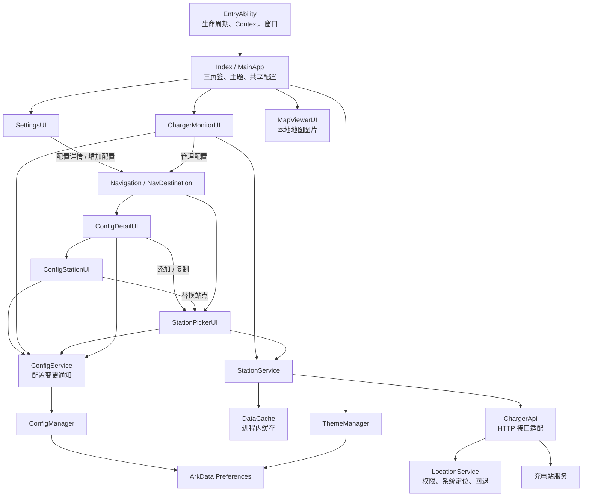

# 充电不愁 · HarmonyOS 7

最近发布 **1.9.0**（versionCode `1009000`）。[下载未签名 HAP](https://github.com/Tinse/Charger_Monitor_For_HarmonyOS/releases/tag/v1.9.0)

面向电子科技大学充电场景的原生 ArkTS / ArkUI 应用。查看充电站插座状态、寻找附近站点、保存常用站点组合，并浏览内置校园地图。

**当前开发基线：HarmonyOS 7，API 26.0.0 Release。编译、目标和最低兼容 API 均为 `26.0.0`，不再支持 HarmonyOS 6 / API 22。**

## 核心功能

| 页面 | 功能 | 实现入口 |
| --- | --- | --- |
| 监控 | 默认查看空闲、占用、故障；点击按钮才查询功率、费用、时长并显示进度。支持搜索、配置顺序及详情排序 | [ChargerMonitorUI.ets](entry/src/main/ets/pages/components/ChargerMonitorUI.ets) |
| 配置 | 监控页切换配置；配置内按显示名称、原站名或 ID 搜索。默认和自定义配置都支持逐站添加、改别名、替换和移除，默认配置可另存为副本 | [ConfigDetailUI.ets](entry/src/main/ets/pages/components/ConfigDetailUI.ets)、[ConfigStationUI.ets](entry/src/main/ets/pages/components/ConfigStationUI.ets)、[StationPickerUI.ets](entry/src/main/ets/pages/components/StationPickerUI.ets)、[ConfigService.ets](entry/src/main/ets/pages/services/ConfigService.ets) |
| 地图 | 内置静态校园地图；双指缩放、单指拖动、缩放按钮和复位；缩放范围 50%～500% | [MapViewerUI.ets](entry/src/main/ets/pages/components/MapViewerUI.ets) |
| 外观 | 跟随系统 / 深色 / 浅色，主题设置保存在本地；底部 HDS 浮动导航栏，支持切换沉浸材质效果 | [Index.ets](entry/src/main/ets/pages/Index.ets)、[ThemeManager.ets](entry/src/main/ets/pages/theme/ThemeManager.ets) |

### 当前源码中的站点管理

下一阶段的配置管理、站点自定义、监控缓存策略与验收条件见[功能设计方案](docs/feature-design.md)。

首次启动包含主楼 C 区（3 站）和商业街（19 站）。从设置点配置名，或在监控点「管理配置」，即可管理这套配置中的站点。[校园站点 ID、名称与坐标](docs/stations.md)

| 操作 | 使用方式与结果 |
| --- | --- |
| 查找 | 在配置详情输入显示名、原站名或站点 ID，可在离线时查阅已保存的站点。点一行进入单站详情。 |
| 添加 | 点「添加站点」，搜索名称、地址或 ID，可按关键词批量选择。已加入的站点有标记，跨关键词选择可以一起保存。 |
| 修改 | 在单站详情编辑别名、备注、暂停状态。支持上下移、替换；替换可选择保留备注，保留别名和顺序。 |
| 移除 | 单站确认移除或跨筛选批量移除。其他配置保留。移除最后一站后保留空配置，可再次添加。 |
| 管理整套配置 | 在配置详情使用「更多」进行整套操作。任意配置均可独立复制，自定义配置可改名。删除确认显示接替监控的配置。设置支持配置与成员搜索。 |

站点 ID 用于查询真实插座。别名、成员和替换操作只作用于当前配置，修改当前监控配置后，监控页同步更新。可以先按名称创建空配置。在空配置的监控页点击「添加站点」，即可继续为这套配置选站。选站器内置 22 个校园站点，联网后还可选择附近查询的结果。恢复默认配置会补回已删除的预设，保留其他配置中已编辑的站点和别名。

首次读取配置出错时，监控页提供「重新读取配置」。设置页会保留最近一次成功读出的列表。存储格式损坏时会阻止写入，避免用默认配置覆盖个人配置。

地图使用内置校园图片。双指缩放以两指中心为焦点，放大后可单指拖动到地图边缘，点击复位可恢复到居中的 100% 视图。

## 软件架构

工程采用 Stage 模型，只有一个 `entry` 模块和一个 `EntryAbility`。主页面和地图沿用 ArkUI 状态管理 V1；监控页、设置首页、配置详情、站点详情、站点选择页、搜索栏和分段控件使用 V2（`@ComponentV2`、`@Local`、`@Param`、`@Event`），明确输入、局部状态和事件契约。没有 WebView、应用自建后端或第三方运行时依赖。



### 数据流与职责

1. **启动**：`EntryAbility` 注入 `ApplicationContext`，初始化配置存储、共享主题状态和主窗口，再加载 `pages/Index`。配置初始化使用共享 Promise，页面读取会等待初始化完成，不依赖已废弃的全局 `getContext()`。
2. **站点监控**按真实站点 ID 复用缓存，使用当前配置的别名展示。冷启动和刷新时显示「已处理 N/M 站」。缓存命中立即回显，其余站使用最多 4 路站点查询，每返回一站便更新卡片和插座统计。查询失败也计入已处理数，成功数单独展示。刷新期间仍能浏览原卡片，未确认的站标为上次记录，顶部数字只统计仍在确认有效期内的站。
3. **附近站点**：`StationService` 检查附近列表缓存；由用户选择位置来源；校园位置直接查询，设备位置委托 `LocationService` 处理定位能力、系统开关和授权，然后使用坐标查询并计算直线距离。此处是直线距离，不是步行或骑行距离。
4. `ConfigManager` 按顺序完成配置的读取、修改和写入。写盘失败时会尝试恢复写入前的值，回滚也失败时提示重新打开应用核对。配置变化后，`ConfigService` 使用一致的当前配置快照通知页面，单个监听回调异常不会阻止其余回调。
5. **界面派生状态**：监控列表的过滤、排序由 V2 `@Monitor` 更新；主题由 `ThemeManager` 映射颜色并保存偏好，窗口状态通过 `AppStateKeys` 共享。

### 刷新、缓存与资源释放

- 基础状态最多并发 4 站，返回一站即展示一站。仅在前台监控可见时，每站成功后 15 秒启动复查；30 秒后退出已确认汇总，10 分钟后隐藏旧数值。
- 统计显示「已确认 X/Y 站」，搜索不改变统计范围。失败、离线与冷启动磁盘快照以历史状态展示；未知数值为「—」。基础状态时间不被缓存命中或详情响应改写。
- 普通刷新只获取基础状态。点击「查询占用详情」后查询整套配置当时已确认的占用插座，详情并发上限 2。显示处理进度、成功/失败/状态变化，慢请求显示等待时间，可停止或仅重试失败项。滚动、展开、排序均不发起详情查询。
- 新一轮基础状态使该站旧详情失效，迟到回包丢弃。功率统一为 W；缺失字段为未知，零值仍显示；按详情排序时未知排末尾，同值按配置顺序。
- 每站合并在途请求；按钮、下拉与失败重试共用 3 秒冷却。临时故障按 15、30、60 秒自动退避，手动可提前重试；接口明确提供的限流期限始终遵守。
- 独立 Preferences 最多保留 128 个仍被配置引用的基础快照。只落盘插座状态和获取时间，费用、时长与设备位置不随快照保存。配置损坏不被默默覆盖，快照损坏不阻止配置使用。
- 进入选站器先显示本地校园目录，离线可勾选保存。点击「查找附近」后明确选择校园位置或设备位置；附近列表按位置来源独立缓存 60 秒。重新定位不清除监控快照。
- 备注、别名、暂停和顺序按配置独立保存。暂停站保留在配置中并退出查询和汇总；全部暂停有管理入口。配置与选站搜索支持名称、原名、ID，配置成员还支持备注。
- HTTP 实例在 `finally` 中销毁；组件离开后停止排队与轮询并隔离迟到响应。监控使用虚拟列表，统计与排序结果按数据变化更新，倒计时不重新遍历插座。

完整的交互规则与时效边界见[功能设计](docs/feature-design.md)，已执行的验证见[功能审查](docs/function-audit.md)。

## 目录

```text
AppScope/                         应用标识、名称
entry/src/main/
├── ets/
│   ├── entryability/             应用入口与窗口管理
│   └── pages/
│       ├── Index.ets             主界面和 HDS 页签
│       ├── ChargerModels.ets     插座、站点、配置等类型
│       ├── ApiConfig.ets         API 地址、坐标和时间参数
│       ├── ConfigManager.ets     Preferences 配置读写
│       ├── PresetConfigs.ets     已核对的两套校园预设
│       ├── AppState.ets          共享状态键
│       ├── api/                  充电站 HTTP 接口
│       ├── services/             配置、站点、定位服务
│       ├── components/           三个页面及实际使用的 UI 组件
│       ├── theme/                主题颜色和持久化
│       └── utils/                缓存、距离计算、错误提示
├── resources/                    地图、图标、字符串、路由
└── module.json5                  Ability、设备类型和权限
build-profile.json5               API 与产品构建配置
hvigor/hvigor-config.json5         Hvigor 开发态版本
oh-package.json5                  包配置（无外部依赖）
scripts/test-core.cjs              使用 SDK 编译器的配置与选择回归
scripts/test-station-picker.cjs    添加、替换、复制及离线选站回归
scripts/test-refresh.cjs           分层请求、并发、时效、持久化与故障回归
scripts/test-monitor.cjs           覆盖率、排序、暂停、历史与详情隔离回归
scripts/test-network.cjs           网络监听、旧响应及注销竞态回归
docs/function-audit.md             按钮与操作审查、验证状态及待办
```

## 开发环境与运行

| 项目 | 要求 |
| --- | --- |
| 系统版本 | HarmonyOS 7 / API 26.0.0 及以上 |
| SDK | HarmonyOS SDK 26.0.0 Release；本机验证的组件版本为 `26.0.0.105` |
| IDE | 配套的 DevEco Studio 26.0.0 Release |
| Node.js | DevEco 工具链使用配套 Node 24.14.1；DevEco CLI 要求 Node 22 及以上 |
| 设备 | phone、tablet；可使用本地 HarmonyOS 7 手机镜像 |
| Bundle | `com.example.uestc_charger_monitor` |

本机设备名称、SDK 安装路径和签名材料不属于仓库配置。安装 CLI 的官方命令为 `npm install -g @deveco/deveco-cli@stable`，可用 `devecocli --version` 检查；本次验证使用 `1.3.13-alpha`，它是 CLI 的预发布版本，不代表项目使用了 Beta SDK。

在工程根目录执行：

```powershell
# 在当前终端指定自己的 DevEco Studio 安装目录，不将路径保存进仓库。
$env:DEVECO_CLI_STUDIO_PATH = Read-Host 'DevEco Studio 安装目录'
$env:DEVECO_SDK_HOME = "$env:DEVECO_CLI_STUDIO_PATH\sdk"

# CLI 自动执行依赖安装、Hvigor 同步和 HAP 构建。
devecocli build

# 选择已有的 HarmonyOS 7 模拟器。
devecocli emulator list
$deviceName = Read-Host '模拟器实例名称'
devecocli emulator start $deviceName
devecocli device list
devecocli run --device $deviceName --debug-line
```

`$deviceName` 使用 `emulator list` 显示的实例名称。无窗口环境可给 `emulator start` 加 `--no-window`。

默认产物为 `entry/build/default/outputs/default/entry-default-unsigned.hap`，当前配置用于允许安装未签名调试包的本地模拟器。真机调试或发布前，使用 DevEco Studio 的 Signing Configs 或 `devecocli signature generate` 配置自己的证书、描述文件和签名；不要复用其他开发者的路径或将签名材料提交到仓库。

### 定位与调试

监控默认站点不要求位置权限。进入选站器不会主动定位。点击「查找附近 → 设备位置」时才申请位置；「校园位置」直接使用校区坐标。用户仅允许模糊定位也可继续查询。定位权限仅声明为使用期间访问。

- 系统定位开关关闭：提示打开设置；未查询时不宣称已使用默认位置。
- 用户拒绝授权、设备不支持定位或定位超时：显示回退状态，按 `ApiConfig` 中的清水河校区附近默认坐标查询。
- 缺少有效坐标的站点显示「距离未知」，不显示成 0 米；有效距离按直线距离排序。
- 模拟器没有真实 GPS；测试附近查询时可注入坐标，返回结果不能用于证明真实设备定位精度。

```powershell
devecocli emulator geolocation --target $deviceName --latitude 30.751 --longitude 103.925
devecocli ui layout --device $deviceName
devecocli ui screenshot --device $deviceName --path .deveco/screenshot.png
devecocli log --device $deviceName --bundle-name com.example.uestc_charger_monitor --tail 100
devecocli log --device $deviceName --bundle-name com.example.uestc_charger_monitor --crash --from 5m
```

若进入配置页仍显示定位未开启，需要先在模拟器系统设置中启用位置服务并授权。CLI 截图路径如已存在，请换用新文件名。

## 接口与数据边界

接口配置集中在 [ApiConfig.ets](entry/src/main/ets/pages/ApiConfig.ets)。当前向 `https://wemp.issks.com` 请求数据：

| 方法 | 路径 | 用途 |
| --- | --- | --- |
| GET | `/charge/v1/outlet/station/outlets/{stationId}` | 站点插座与状态 |
| GET | `/charge/v1/charging/outlet/{outletNo}` | 占用插座详情 |
| POST | `/device/v1/near/station` | 坐标附近的站点 |

请求的 Origin / Referer 使用 `https://api.issks.com`。附近查询单次请求最多 200 个站点；页面展示的是接口结果，不保证覆盖整个区域。状态更新频率和可用性取决于第三方服务与本地缓存。设备坐标会随附近查询发送给该服务；常用站点组合和主题偏好保存在应用沙箱中的 Preferences，当前没有云同步和备份扩展。

## HarmonyOS 7 适配

- `compileSdkVersion`、`targetSdkVersion`、`compatibleSdkVersion` 均设为 `26.0.0`，`modelVersion` 同步为 `26.0.0`。
- 使用 `@kit.NetworkKit`、`@kit.ArkData`、`@kit.ArkUI` 等 Kit 入口；偏好存储使用显式注入的 Context。
- 弹窗通过 `UIContext.getPromptAction()` 调用，地图复位动画通过 `UIContext.animateTo()` 调用。
- HDS 沉浸材质只用于底部 TabBar 的有效区域；移除了低版本底栏分支。
- 地图工具栏和保存按钮避让浮动底栏，复位操作不再被页签触摸区域遮挡。
- 搜索栏和分段控件使用 V2 `@Event` 声明对外事件，避免把普通或 `private` 字段当成受管理的事件接口。
- 清理空备份扩展、空测试模板与未引用组件，将过期架构说明和优化清单合并到本 README；`oh_modules`、构建产物、IDE 文件和本机路径不再作为源码维护。

截至 2026-11-25，官方 `26.0.0` 为 Release，`26.0.1` 为 Beta1。本项目选择正式版，不将营销系统版本 `7.0.0` 直接填入 SDK 配置。

参考：[26.0.0 Release 配套信息](https://developer.huawei.com/consumer/cn/doc/harmonyos-releases/overview-2600/)、[26.0.1 Beta1 配套信息](https://developer.huawei.com/consumer/cn/doc/harmonyos-releases/overview-2601/)、[向 API 26.0.0 升级指导](https://developer.huawei.com/consumer/cn/doc/harmonyos-releases/upgrade-adaptation/)、[API 26 行为变更](https://developer.huawei.com/consumer/cn/doc/harmonyos-releases/changelogs-overview-2600/)。

## 验证范围

逻辑回归使用 SDK 自带的 TypeScript 编译器加载当前 ArkTS 模块。`test-core` 通过内存 Preferences 验证配置增删改、默认配置迁移与恢复、并发写入、配置损坏保护、写盘失败回滚、监听回调异常、选择站点完整性和外观设置回滚。

```powershell
node scripts/test-core.cjs
node scripts/test-refresh.cjs
node scripts/test-station-picker.cjs
node scripts/test-monitor.cjs
node scripts/test-network.cjs
```

刷新脚本用可控时钟、站点服务替身和模拟 HTTP 响应，覆盖冷却与慢请求互斥、全部或部分失败、并发上限、缓存清除后的旧响应、定位来源与实际获取时间，以及功率单位和缺失字段的解析。

逐按钮的源码审查、逻辑测试覆盖和模拟器验证状态记录在 [功能审查报告](docs/function-audit.md)。本轮模拟器状态应按实际执行证据回填，不沿用上一版本的通过结果。设备回归时至少核对：

1. HAP 元数据的 Release SDK 与编译 / 目标 / 最低 API；构建成功后设备上仍存在应用进程和可见页面。
2. 默认监控数据、搜索和排序、手动刷新、隐藏页面暂停自动刷新。
3. 地图缩放、拖动和复位；主题切换及重新启动后恢复。
4. 附近站点获取、权限拒绝 / 模糊授权 / 定位开关关闭的处理。
5. 配置创建、切换、编辑、默认与自定义删除、重启后不复活、删除最后配置后的空态，以及恢复默认与同名冲突；检查本次运行的崩溃记录。

本地验证日志和截图写入 `.deveco/harmony7-validation/`，该目录不提交 Git。模拟器验证不等同于真机性能测量或应用市场发布验收。

## 界面设计参考

导航使用透明背景的单色系统 Symbol，当前页签以蓝色强调。设置采用浅灰画布、圆角分组卡片与分级文字；配置详情、新增与编辑通过 Navigation / NavDestination 提供系统返回和二级页面转场，保存操作避让系统导航条。深色模式使用独立配色。

参考华为官方：[HarmonyOS Symbol](https://developer.huawei.com/consumer/cn/doc/design-guides/system-icons-0000001929854962/)、[工具栏与安全区域](https://developer.huawei.com/consumer/cn/doc/design-guides/toolbar-0000001929683232/)、[HDS 浮动页签](https://developer.huawei.com/consumer/cn/doc/HarmonyOS-Guides/ui-design-hds-tabs-bar-floating/)、[Navigation](https://developer.huawei.com/consumer/cn/doc/HarmonyOS-Guides/arkts-navigation-navigation/)。此前界面改版的模拟器截图位于 `.deveco/settings-redesign/`；本轮功能修复的验证状态以 [功能审查报告](docs/function-audit.md) 为准。

## 公开仓库与本机配置

仓库仅维护可公开的源码、资源、构建基线和文档。SDK 安装位置通过环境变量指定；设备实例、签名证书、私钥、凭据、本地日志和调试产物保存在 Git 忽略的本机文件中。请勿在构建配置或文档中写入开发者目录、私人邮箱或真实签名参数。
